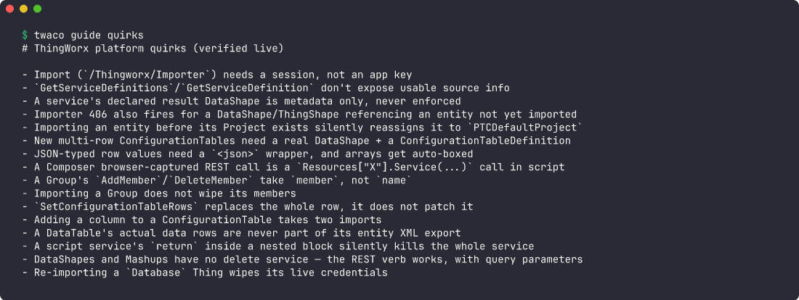
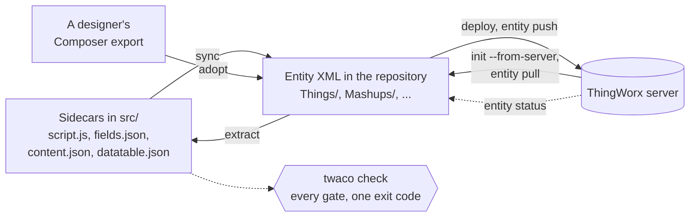
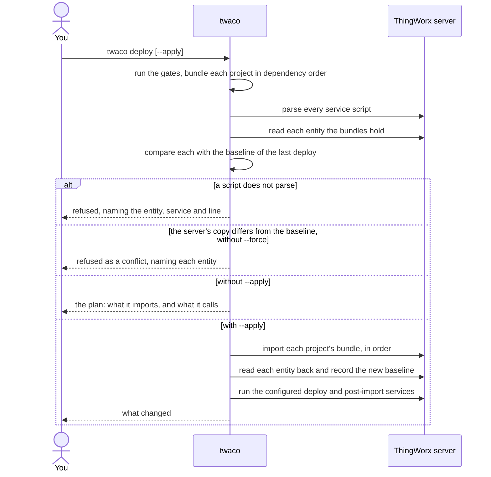
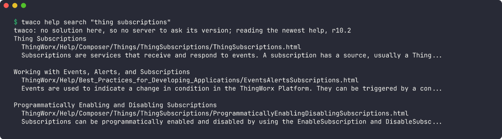
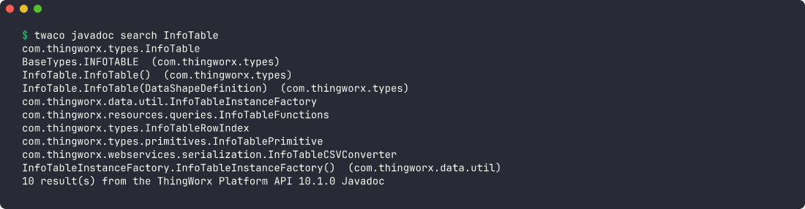
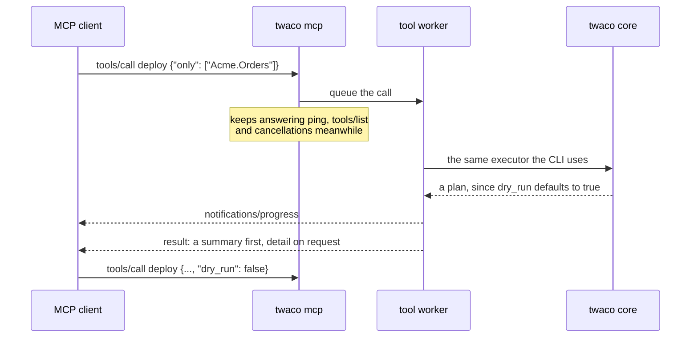
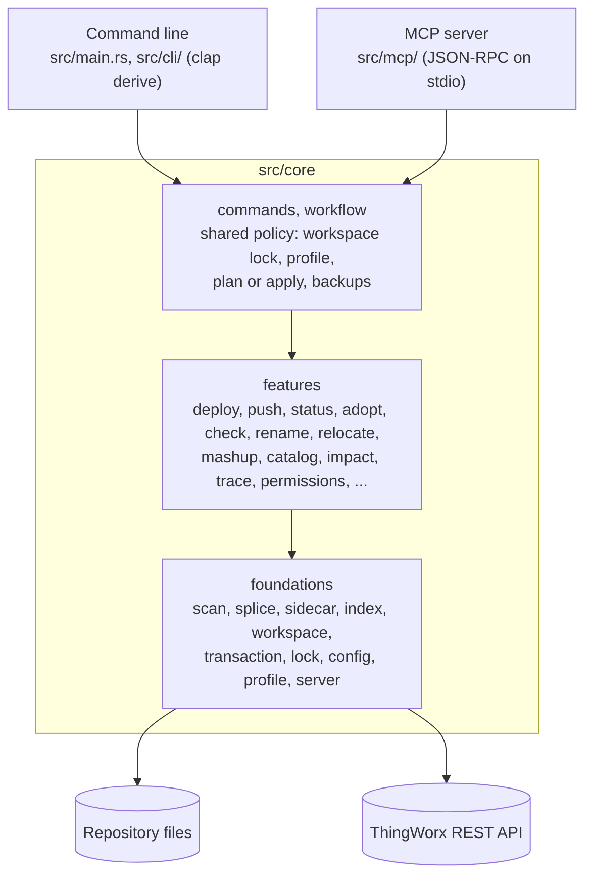

<div align="center">


# twaco

**Keep a ThingWorx solution in source control, and work on it from a terminal or an AI agent.**
**Service scripts as files, safe deploys, and the platform's knowledge one command away.**

[](https://github.com/butteredstardust/twaco/releases/latest)
[](https://github.com/butteredstardust/twaco/actions/workflows/ci.yml)
[](LICENSE)
[](https://github.com/butteredstardust/twaco/releases/latest)

<br>



</div>

---

ThingWorx keeps a solution's code inside entity XML: every service script sits in a CDATA
section of a Thing, ThingTemplate or ThingShape export. That is hard to edit, review, diff or
hand to an AI agent.

twaco is a single command-line binary that makes the repository the source of truth:

- **Scripts become files.** `twaco extract` writes every service script, DataShape, mashup and
  DataTable configuration out to sidecar files. `twaco sync` writes them back byte for byte,
  touching nothing else in the XML.
- **Start from a server, or from exports.** `twaco init` proposes a `twaco.toml` from a folder
  of entity exports; `twaco init --from-server <project>` starts a repository from server
  projects, and `entity pull` takes in what changed on the server since.
- **Build without Composer.** `twaco new` creates Things, templates, shapes, DataShapes,
  DataTables, streams, timers, schedulers, styles, themes, state definitions, menus and media.
  `twaco thing service|property|subscription|shape` adds, changes and removes what they hold, and
  `twaco mashup` builds responsive mashups from templates: widgets, bindings, events, parameters,
  contained mashups and ready-made wiring. Every one plans until `--apply` and writes the XML as
  Composer would.
- **Refactors that follow every reference.** `twaco rename` renames an entity, a prefix, a
  DataShape field, a service, a parameter, a configuration table or a property, through entity
  XML, sidecars, mashup JSON and `twaco.toml`. `move` and `copy` lift a service or property to
  another entity; `retemplate` and `reproject` change what an entity inherits and where it
  belongs. Each plans first and says what the server will not carry over.
- **Know before you change.** `twaco catalog Entity.Service --body` shows a service's signature,
  origin and script; `impact` lists what a change reaches, `trace` how each caller uses a
  service, `unused` what nothing reaches, and `mashup describe` a mashup's wiring without its XML.
  `contract diff` compares the public services with a git revision, `requirements check` holds
  the solution to the external entities, extensions and platform version it declares, and
  `docs` writes the whole solution down as Markdown.
- **Checks before the server sees it.** `twaco check` runs every gate in one pass: sidecars in
  sync, line endings, formatting, script traps the Rhino engine punishes, code order, project
  validation, mashup bindings against their services' DataShapes, mashup content, contained mashups,
  localization tokens, result shapes and your own hooks. `twaco types --check` type-checks every
  service against the entities' declarations with TypeScript.
- **Deploys that refuse to clobber.** `twaco deploy` bundles per project in dependency order,
  has the server parse every script, and refuses when someone changed the server since your
  last deploy. It orders what the server is strict about, such as an AI agent that must stop
  allowing a tool before its MCP namespace drops it. Every command that writes to a server only
  plans unless you add `--apply`, except `twaco call`, which runs the service you name.
- **Solution Framework building blocks.** `twaco new building-block` creates one as the
  framework does, `block list|show --server` sets each beside the framework's version, state and
  deploy order, and `block version` keeps its two version numbers together. With
  `[project.deploy] framework = true`, a deploy runs the block's own deploy step as the framework
  does, skipping a block the framework has configured unless `--redeploy-blocks`, and a block's
  lifecycle state stays the server's.
- **Extensions, Java and widgets.** `twaco ext new` lays out a Java extension project with its
  Gradle build and wrapper, or with `--widget` a TypeScript widget project in the ThingWorx widget
  template's pattern; `ext add` adds templates, shapes, resources, widgets and jars. `ext check`
  holds metadata.xml to the source, `ext build` builds any of them (npm, yarn, pnpm, Gradle, Ant,
  the template's webpack and gulp projects included) and checks the zip, and `ext deploy` builds
  and installs it (`--bump` raises the version first, which the server needs for a change) and
  confirms what the server lists. `ext intellij` adds IntelliJ live
  templates for the extension annotations.
- **A designer's Composer work, adopted cleanly.** `twaco adopt` compares a Composer export
  with the repository and shows what really changed, ignoring Composer's noise.
- **The server, from the terminal:** service calls (as a test user, in another language) with
  the logs they wrote, logs and log levels, SQL through a Database Thing, DataTable row copies,
  permissions as policy, localization tables, test users and service tests, application keys,
  file repositories, extensions, exports, imports, configuration tables and subsystem settings.
- **Knowledge for agents:** verified-live platform quirks, the service catalog, and the
  ThingWorx help center and Java API docs, searchable from the CLI. The Java API docs read from
  a local Extension SDK too, offline and at its version.
- **An MCP server.** `twaco mcp` serves its commands as tools to Claude Code, Codex, Cursor or any
  MCP client, in groups an agent can load on their own. Server writes are dry runs unless
  the agent says otherwise.

twaco runs on Windows, Linux and macOS, needs no runtime, and works offline for everything
that does not need a server.

## How it works

The repository holds the entity XML that ThingWorx exports, and twaco keeps the parts you
edit beside it as plain files. Every arrow that reaches the server plans until `--apply`.



`sync` writes back only the spans it changed, so an untouched entity stays byte for byte the
same. `deploy` runs the gates, bundles each project in dependency order, and refuses before it
imports anything when a script does not parse, or when the server's copy of an entity is not the
one your last deploy left there (changed, deleted, or never recorded) and `--force` is absent:



## Create, read, change, delete

What twaco can do to each part of a solution, without opening Composer. Repository changes plan
until `--apply`; `sync` and `deploy` take them to the server.

| Part | Create | Read | Change | Delete |
| --- | --- | --- | --- | --- |
| Service | `thing service add` | `catalog <Entity>.<Service> --body`, `trace` | edit `script.js` + `sync`; `rename service`, `rename param`, `move service`, `copy service` | `thing service remove` |
| Property | `thing property add` | `catalog <entity>`, `impact --member` | `thing property set`; `rename property`, `move property`, `copy property` | `thing property remove` |
| Subscription | `thing subscription add` | the entity's XML | remove and add | `thing subscription remove` |
| Thing, ThingTemplate, ThingShape | `new thing`, `new thing-template`, `new thing-shape` | `catalog`, `impact`, `entity get` | `thing shape add\|remove`, `retemplate`, `reproject`, `rename entity` | `entity delete` |
| DataShape | `new data-shape` | `src/<DataShape>/fields.json` | edit `fields.json` + `sync` (its DataTables and Streams follow); `rename field` | `entity delete` |
| DataTable, Stream, ValueStream | `new data-table`, `new stream`, `new value-stream` | `datatable.json`, `db query` | `datatable.json` + `sync`; `datatable copy` for rows | `entity delete` |
| Mashup | `mashup new` (14 templates), `mashup add-contained` | `mashup describe`, `mashup validate` | `mashup add`, `bind`, `on`, `param`, `event`, `recipe` | `entity delete` |
| Timer, Scheduler | `new timer`, `new scheduler` | the entity's XML | `timer set`, `scheduler set` | `entity delete` |
| Style, theme, state, menu, media | `new style`, `new theme`, `new state`, `new menu`, `new media` | the entity's XML | `style set`, `state set`, `menu item add\|remove`, `media set` | `entity delete` |
| Network (asset hierarchy) | `new network`, `network import` | `network list`, `network show` | `network add`, `network move` | `network remove` (connections, never the Things) |
| AI agent, MCP namespace | `new ai-agent`, `new mcp-namespace` | `impact`, `check` (`ai references`) | `mcp-namespace add\|remove`, `agent allow\|disallow`, `agent taxonomy`, `agent skill`, `agent set` | `entity delete` |
| Building block | `new building-block` | `block list`, `block show` (`--server`: the framework's state), `projects`, `docs` | `block version`, `rename prefix`; `deploy` runs its deploy step | `entity delete` of its entities |
| Java extension | `ext new` | `ext check`, `ext list`, `ext show` | `ext add thing-template\|thing-shape\|resource\|widget\|jar`, `ext build`, `ext deploy` | `ext remove` |
| Widget extension | `ext new --widget` | `ext check`, `ext list`, `ext show` | edit `src/`, then `ext build`, `ext deploy` | `ext remove` |
| Permissions | `permissions init` (drafts `permissions.toml` from the entities) | `permissions audit`, `permissions diff` | `permissions apply`, then `permissions push` | drop it from the policy, then `apply` and `push` |
| Localization token | `localization new`, `localization set` | `localization status` | `localization set`, `localization push` | `localization remove` |
| Test user | `users seed` | `users list` | | `users delete` |
| Application key | `appkey create` | `appkey show` | | `appkey delete` |
| File repository | `repo put`, `repo mkdir` | `repo ls`, `repo get`, `repo status` | `repo mv`, `repo push`, `repo pull` | `repo rm` |
| Server entity | `entity push`, `deploy`, `import` | `entity status`, `entity get`, `search`, `export` | `entity push`, `entity carry` (permissions after a rename) | `entity delete`, then `entity restore` to undo |

## No server needed

These commands work before you connect to a server.

`twaco guide` reads the platform quirks that twaco's authors verified on a live server, as the
screenshot at the top shows.

`twaco help search` searches the ThingWorx help center:



`twaco javadoc search` searches the ThingWorx Java API:



## Install

Open the [latest release](https://github.com/butteredstardust/twaco/releases/latest) and
download the installer for your platform. Each merge to `main` that changes the binary
publishes a new release.

| Platform              | Installer                               | Installs to                         |
| --------------------- | --------------------------------------- | ----------------------------------- |
| Windows x64           | `twaco-<version>-x64-setup.exe`         | `%LOCALAPPDATA%\Programs\twaco`, on your `PATH` |
| macOS (Apple Silicon) | `twaco-<version>-aarch64-apple-darwin.pkg` | `/usr/local/bin/twaco`           |
| Linux x64 (Debian, Ubuntu) | `twaco_<version>_amd64.deb`        | `/usr/bin/twaco`                    |
| Linux x64 (other)     | `twaco-<version>-x86_64.AppImage`       | wherever you put the file           |

- The Windows installer needs no administrator. Uninstall twaco from Settings > Apps. The
  uninstaller removes the `PATH` entry only when the installer added it.
- The Linux binary, `.deb` and AppImage need glibc 2.35 or later, as in Ubuntu 22.04.
- The macOS package is not signed, so Gatekeeper blocks a double-click. Right-click it and
  choose Open, or run `sudo installer -pkg twaco-<version>-aarch64-apple-darwin.pkg -target /`.
- Make the AppImage executable (`chmod +x`) and put it on your `PATH`, renamed to `twaco`.

Each release also has a plain archive per platform (`twaco-<version>-<target>.zip` or
`.tar.gz`): unpack it and put `twaco` (or `twaco.exe`) on your `PATH`. `SHA256SUMS.txt` lists
the checksum of every asset. Or build from source with Rust:

```sh
cargo install --git https://github.com/butteredstardust/twaco
```

`twaco types --check` also needs TypeScript (`npm install -g typescript`). Building extensions
needs their own tools: Node and npm (or yarn, pnpm) for a widget project, whose first build
installs the rest, and a JDK for a Java one, with Gradle once to add its wrapper. Nothing else
does.

### Updates

Once a day, a command run in a terminal checks for a newer release. When one exists, twaco
writes one line on stderr after the command's own output. `twaco mcp`, `twaco completions`, CI
and a redirected stderr never check. Set `TWACO_NO_UPDATE_CHECK=1` to turn the check off.

```sh
twaco update           # compare with the latest release
twaco update --apply   # download it, verify its signature, and replace this binary
```

- On Windows, macOS and from an archive, `twaco update --apply` replaces the binary in place.
  For `/usr/local/bin/twaco`, run it with `sudo`.
- `twaco update` does not replace a `.deb` install or an AppImage. Install the next release's
  `.deb` or AppImage instead.

### Shell completions

`twaco completions <shell>` writes a completion script for bash, elvish, fish, powershell or zsh
on stdout: every command and flag, with the descriptions `twaco` lists, and in bash and zsh the
action words too (`users list|seed|delete`).

```sh
twaco completions bash > ~/.local/share/bash-completion/completions/twaco
twaco completions zsh > "${fpath[1]}/_twaco"
twaco completions fish > ~/.config/fish/completions/twaco.fish
```

## Quick start

From the root of a repository holding ThingWorx entity exports (`Things/`, `ThingShapes/`,
`Mashups/` and so on):

```sh
twaco init                 # propose a twaco.toml from the entities themselves
twaco init --write         # write it, plus AGENTS.md and CLAUDE.md for agents
twaco extract --all        # scripts, DataShapes and mashups out to sidecar files under src/
twaco check                # every gate, one exit code
```

Edit a service in `src/<Entity>/services/<Service>/script.js`, then:

```sh
twaco sync <Entity>                         # write it back into the entity XML
twaco check
twaco deploy --only <Entity>                # the plan: what it imports, and any conflict
twaco deploy --only <Entity> --apply        # do it
twaco call <Thing> <Service> '{"x": 1}' --with-logs
```

Talking to a server needs a profile. Create `.twaco/profiles/default.toml` (it is
git-ignored):

```toml
url = "http://localhost:8080/Thingworx"
username = "Administrator"
password = "..."
```

`twaco doctor` shows what resolved, whether the server answers and which ThingWorx version it runs. See
[Quick start](documentation/QUICK_START.md) for the full walk-through.

## Use it with an AI agent

```sh
claude mcp add twaco -- twaco mcp           # Claude Code, from the solution's root
```

Any MCP client works: run `twaco mcp` with the solution as its working directory, or set
`TWACO_ROOT`. Tools that write to the server default to `dry_run: true`, and results are
summaries unless the agent asks for detail, so a large solution stays affordable in context.
The 88 tool definitions together take about 160 KB of an agent's context (104 KB for a client
without output schemas); `twaco mcp --tools core,entity` (or `TWACO_MCP_TOOLS`) serves only the
groups it needs (`core`, `entity`, `refactor`, `mashup`, `permissions`, `data`, `server`,
`reference`). `core` alone, the everyday loop, is about 35 KB. See
[MCP server](documentation/MCP_SERVER.md).



Tool calls run one at a time, in the order they arrive. A cancelled call that has not started
never starts; one that has runs to its end, so a server write is never stopped halfway.

`twaco init --write` also writes an `AGENTS.md` and a `CLAUDE.md` that point an agent at
`twaco guide`, the workflow, the platform's quirks, and the commands to run before grepping:
`catalog <Entity>.<Service> --body`, `impact`, `trace`, `mashup describe` and `entity status`.

## How it is built

One Rust crate: a library with every behaviour in `core`, and two thin front ends that parse,
call it and print or return JSON. So a command and its MCP tool agree.



[Architecture](documentation/ARCHITECTURE.md) names the principles and where everything lives.

## Documentation

| Document | What it covers |
| --- | --- |
| [Quick start](documentation/QUICK_START.md) | From a folder of exports to a first deploy |
| [User guide](documentation/USER_GUIDE.md) | The repository layout, the change loop, creating and changing entities and mashups, refactors, deploys, adopting a designer's work, permissions, localization, testing as users, releases |
| [Commands](documentation/COMMANDS.md) | Every command and flag |
| [Configuration](documentation/CONFIGURATION.md) | `twaco.toml` and server profiles |
| [MCP server](documentation/MCP_SERVER.md) | Setup and the tools an agent gets |
| [Knowledge](documentation/KNOWLEDGE.md) | `guide`, `catalog`, `help`, `javadoc` and `types` |
| [Architecture](documentation/ARCHITECTURE.md) | How twaco works inside, for contributors |
| [Mutation classes](documentation/MUTATION_CLASSES.md) | What may have changed after each command or tool fails |
| [Transactions](documentation/TRANSACTIONS.md) | How multi-file changes are journaled and recovered after a crash |
| [Command facade](documentation/COMMAND_FACADE.md), [MCP schemas](documentation/MCP_SCHEMAS.md), [Testing](documentation/TESTING.md) | For contributors: the shared command policy, the tools' result shapes, and how to run the tests |

## Safety

twaco is built to be run against servers people depend on:

- **Plans first.** Every command that changes a server prints a plan unless given `--apply`
  (MCP: `dry_run: false`). The exception is `twaco call` on the command line, which runs the
  service you name: twaco cannot know whether a service writes.
- **Conflicts are refused.** `deploy` and `entity push` compare the server with the baseline
  recorded at the last deploy or push (or adopted with `entity status --record`), and refuse
  to overwrite someone else's change unless you `--force` it.
- **Your own files are not overwritten quietly.** A file you name for `export`, `package` or
  `repo get --out` is not replaced without `--force`, and a `config-table` backup is never
  written over. twaco's managed outputs (entity XML, sidecars, the bundle) are rewritten by
  the commands that own them, and so is the file you give `entity get --out`.
- **Credentials stay out of the repository.** Profiles live under `.twaco/profiles/` or your
  home folder, are never printed, and checks only receive them when they ask. An application
  key is printed only with `--show`.
- **Multi-file changes are all or nothing.** Renames, entity and mashup edits, adopt and the
  other commands that change several files write them in one journaled transaction; after a
  crash the next command finishes or undoes it.
- **Deletes are guarded.** `entity delete` plans, refuses while something on the server still
  depends on the entity or the repository still defines it, and backs it up so `entity restore`
  can bring it back.

## Contributing

Bug reports, fixes and new gates are welcome. Read [CONTRIBUTING.md](CONTRIBUTING.md) first.
Report security issues privately, as [SECURITY.md](SECURITY.md) describes.

## License

[MIT](LICENSE).

The maintainer made the twaco icon in `assets/icon`. The icon has the same MIT license as
the code.

ThingWorx is a trademark of PTC Inc. twaco is an independent project. It is not affiliated
with, sponsored or endorsed by PTC. The help center and Javadoc that `twaco help` and
`twaco javadoc` read are fetched from PTC's public site at run time and cached on your
machine; they are not part of this repository.
